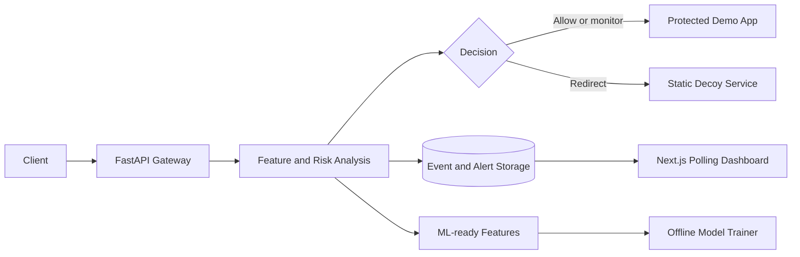

# Project MIRAGE

Project MIRAGE is an experimental cyber-deception platform for API traffic. The
current repository provides a working local MVP prototype: a guarded FastAPI proxy scores requests with
heuristics and optional Random Forest shadow models, forwards normal traffic to a protected demo app, redirects suspicious
traffic to an isolated static decoy, persists security events, and exposes them
through a real-time Next.js dashboard with resilient polling fallback.

See `docs/PROPOSAL_ALIGNMENT.md` for the complete proposal capability matrix.

## What Works

- guarded reverse proxy at `/api/v1/proxy/*`;
- heuristic live routing plus guarded experimental `hybrid` and `ml_only` modes;
- isolated protected-demo and adaptive static-decoy services;
- bounded request bodies, upstream timeouts, credential filtering, and rate limits;
- SQLite development storage, PostgreSQL/Alembic, and Supabase cloud pooler configuration (`.env.supabase.example`);
- dashboard metrics, events, alerts, traffic history, and simulation controls;
- authenticated WebSocket dashboard snapshots for events, alerts, metrics,
  traffic, risk history, decoy status, training readiness, ML shadow status,
  honeytokens, canary assignments, and actor/case workflows;
- versioned ML-ready request and bounded payload-shape features, ML shadow scoring,
  and offline/automated Random Forest training pipelines;
- a locally reviewed CSIC 2010 benchmark plus deterministic API-domain pipeline fixtures;
- cloud deployment scaffolding for Vercel, three Railway services, and Supabase;
- analyst event labels for future training data curation;
- JSONL export and readiness checks for analyst-labeled training records;
- repeatable local API-domain collection and deterministic pipeline fixture (`python scripts/generate_custom_api_dataset.py`);
- payload signature detection that decodes URL, double-URL, HTML-entity,
  `\u`-escaped, full-width, and comment-obfuscated input; a single recognized
  attack signature routes the request to the decoy (see
  `docs/dataset-preparation.md` for the CSIC 2010 evaluation);
- honeytoken detection for configured decoy credentials;
- adaptive decoy responses with epoch-rotatable per-actor synthetic canary tokens;
- persistent canary assignment records with hashed token values, operator revoke
  controls, and dashboard visibility;
- persistent actor profiles, lightweight actor clusters, and persisted case triage workflows;
- Docker Compose configuration for the five-service stack.

## Current Boundaries

- The gateway proxies requests under its explicit `/api/v1/proxy/*` route.
- Live routing defaults to `heuristic`. Experimental `hybrid` or `ml_only`
  behavior also requires `ML_LIVE_ROUTING_APPROVED=true` after review.
- Decoy payloads are synthetic and can issue deterministic per-actor canary
  tokens with epoch-based rotation; assignment and revoke records exist for
  operator review, but multi-operator approval workflows are not implemented.
- Cloud manifests are configuration scaffolding and still require provisioning,
  environment setup, migrations, and end-to-end verification.

## Architecture



| Service | Local port | Purpose |
| --- | ---: | --- |
| Web | `3000` | Landing page, dashboard, and server-side simulation bridge |
| Gateway | `8000` | Inspection, proxy routing, dashboard API, and persistence |
| Protected demo app | `8001` | Upstream for allowed or monitored traffic |
| Decoy | `8002` | Upstream with static synthetic responses |
| PostgreSQL | internal | Compose persistence backend |

## Quick Start

### Prerequisites

- Docker Desktop with Docker Compose; or
- Node.js 20+ and Python 3.11+ for standalone development.

### Full Stack With Docker

From the repository root:

```bash
# Windows
Copy-Item .env.example .env

# Linux/macOS
cp .env.example .env
```

Fill every variable marked `REQUIRED` in `.env`:

- `POSTGRES_PASSWORD` must be strong and URL-safe.
- `DATABASE_URL` must use the `postgresql+asyncpg` driver, host `db`, and the
  same user, password, and database configured by `POSTGRES_*`.
- `MIRAGE_API_KEY` protects every dashboard endpoint and stays server-side.
- `MIRAGE_OPERATOR_SESSION_SECRET` and `MIRAGE_DASHBOARD_TICKET_SECRET` must be
  independent random values of at least 32 characters.
- `MIRAGE_DASHBOARD_WS_URL` is the browser-reachable stream URL; use `wss://`
  and set `MIRAGE_SECURE_COOKIES=true` for HTTPS staging.
- `DECOY_*` values must be synthetic and invalid on every real system.
- `DECOY_CANARY_EPOCH` can be increased when rotating newly issued canary
  tokens.

The compose gateway runs with `APP_ENV=production` and refuses to start when
the configuration is unsafe: an API key or ticket secret shorter than 32
characters, placeholder decoy tokens, an in-memory database, or a model
artifact without `MIRAGE_MODEL_ARTIFACT_SHA256`. Optional hardening settings:

- `TRUSTED_PROXIES`: comma-separated IPs or CIDRs of reverse proxies whose
  `X-Forwarded-For` is honored (empty: forwarded headers are ignored).
- `PAYLOAD_EXEMPTIONS`: rules such as `POST /api/posts:xss;PUT /api/snippets/*:rce-indicator`
  for routes that legitimately accept code or rich text. Labels are removed
  from routing only, recorded in the event summary, and never applied to
  non-canonical paths (`..`, `%`, `\`, `;`, `//`).
- `MIRAGE_MODEL_ARTIFACT_SHA256`: pins the model file; the retraining result
  reports the digest of each new artifact.
- `PROXY_MAX_RESPONSE_BYTES` (10 MiB) and `RATE_LIMIT_MAX_CLIENTS` (10,000)
  bound gateway memory.
- The dashboard is published on `127.0.0.1` by default
  (`WEB_BIND_ADDRESS`). Its login allows 5 failures per client and 50 in total
  per 15 minutes. Without a trusted reverse proxy every client shares one
  budget, so anyone who can reach the login could lock operators out. Before
  exposing it, put a TLS reverse proxy in front, set
  `MIRAGE_TRUST_PROXY_HEADERS=true` (the proxy-appended `X-Forwarded-For` hop
  identifies the client), and set `WEB_BIND_ADDRESS` to the proxy-facing
  address.

### Operator Accounts

Each analyst signs in with their own username and password. Accounts live in
the gateway database with scrypt password hashes. After the stack is up,
create the first admin (the command prompts for the password twice; 12 to 256
characters):

```bash
docker compose --env-file .env -f infra/docker-compose.yml exec gateway python scripts/manage_operators.py create admin --role admin
```

Outside Docker, run the same script from `apps/gateway` with its virtual
environment active: `python scripts/manage_operators.py create admin --role admin`.
The script also lists accounts and can `disable`, `enable`, `reset-password`
and `set-role`; a disabled account loses access on its next request.

Roles: `analyst` can label events and open, assign and update cases. `admin`
can also run retraining, revoke canary assignments and read the audit log.
Labels, case changes, retraining and canary revocation record who did them.

Networks are segmented: the decoy and the protected app are reachable only
from the gateway, and Postgres only from the gateway. Containers run as
non-root users with `no-new-privileges`.

Then start the stack:

```bash
docker compose --env-file .env -f infra/docker-compose.yml up --build
```

Open:

- dashboard: `http://localhost:3000/dashboard` by default, or the port set in
  `WEB_PORT`;
- gateway health: `http://localhost:8000/health` (returns only `{"status": "ok"}`).

API docs (`/docs`, `/openapi.json`) exist only with `APP_ENV=development`, so
the attacker-facing port never describes the gateway.

Stop the stack with:

```bash
docker compose --env-file .env -f infra/docker-compose.yml down
```

The root `.env` is ignored by Git. Commit variable names and documentation only
through `.env.example`.

## Demo

With the full stack running, send normal traffic through the proxy:

```bash
curl -H "User-Agent: Mozilla/5.0" http://localhost:8000/api/v1/proxy/api/products
```

Send a suspicious probe to exercise decoy routing:

```bash
curl -H "User-Agent: sqlmap/1.8" http://localhost:8000/api/v1/proxy/.env
```

Open `http://localhost:3000/dashboard` to inspect the resulting events and
alerts. The dashboard simulation buttons call a server-side Next.js route, so
`MIRAGE_API_KEY` is never exposed in the browser bundle.

For a direct operator simulation call:

```bash
curl -X POST -H "X-Mirage-API-Key: YOUR_LOCAL_MIRAGE_API_KEY" http://localhost:8000/api/v1/simulate/suspicious
```

## Standalone Development

Run each backend service in a separate terminal from the repository root.

### Gateway

```bash
cd apps/gateway
python -m venv .venv
# Windows: .venv\Scripts\activate
# Linux/macOS: source .venv/bin/activate
python -m pip install -e ".[dev,ml,postgres]"
# Windows: Copy-Item .env.example .env
# Linux/macOS: cp .env.example .env
python -m alembic upgrade head
uvicorn app.main:app --reload --port 8000
```

### Protected Demo App

```bash
cd apps/real-app-demo
python -m pip install -e .
uvicorn app.main:app --reload --port 8001
```

### Decoy

```bash
cd apps/decoy
python -m pip install -e .
uvicorn app.main:app --reload --port 8002
```

### Web

Copy `apps/web/.env.example` to `apps/web/.env.local`. Set
`MIRAGE_INTERNAL_API_URL` to the standalone gateway and use the same
`MIRAGE_API_KEY` configured by the gateway.

```bash
cd apps/web
npm install
# Windows: Copy-Item .env.example .env.local
# Linux/macOS: cp .env.example .env.local
npm run dev
```

## Gateway API

All paths below use the `http://localhost:8000` base URL.

The dashboard bridge sends `X-Mirage-Operator` with the API key to name the
signed-in analyst; "admin" in the Auth column means that operator must hold the
admin role. A request with the API key and no operator header acts as the
built-in `api-key` admin.

| Method and path | Auth | Purpose |
| --- | --- | --- |
| `GET /health` | Public | Health check |
| `POST /api/v1/inspect` | API key | Inspect submitted request metadata |
| `* /api/v1/proxy/{path}` | Public | Inspect and forward real HTTP traffic |
| `POST /api/v1/simulate/normal` | API key | Generate a normal demo event |
| `POST /api/v1/simulate/suspicious` | API key | Generate a suspicious demo event |
| `GET /api/v1/dashboard/*` | API key | Dashboard metrics, events, alerts, and charts |
| `GET /api/v1/dashboard/training-data/export` | API key | Export analyst-labeled feature vectors as JSONL |
| `GET /api/v1/dashboard/training-data/summary` | API key | Check labeled row counts and class balance before training |
| `POST /api/v1/dashboard/training-data/retrain` | API key, admin | Train a local shadow-mode candidate artifact from analyst labels |
| `GET /api/v1/dashboard/ml-shadow/status` | API key | Report sanitized ML shadow artifact readiness |
| `GET /api/v1/dashboard/ml-shadow/summary` | API key | Summarize recent model-only agreement with heuristic routing |
| `GET /api/v1/dashboard/ml-promotion/readiness` | API key | Evaluate guarded promotion prerequisites without changing routing |
| `GET /api/v1/dashboard/honeytokens` | API key | Show recent decoy credential interactions |
| `GET /api/v1/dashboard/canary-assignments` | API key | Show issued canary assignment lifecycle records |
| `POST /api/v1/dashboard/canary-assignments/{assignment_id}/revoke` | API key, admin | Revoke a canary assignment for operator lifecycle tracking |
| `GET /api/v1/dashboard/actors` | API key | Show recent actor profiles grouped by threat fingerprint |
| `GET /api/v1/dashboard/actor-clusters` | API key | Show lightweight actor clusters for triage |
| `GET /api/v1/dashboard/actor-cases` | API key | Show recommended investigation cases |
| `GET /api/v1/dashboard/actor-case-workflows` | API key | Show persisted actor case workflow records, optionally filtered by status or assignee |
| `POST /api/v1/dashboard/actor-cases/{case_id}/open` | API key | Open a recommended actor case workflow |
| `PATCH /api/v1/dashboard/actor-case-workflows/{case_id}` | API key | Update an actor case workflow status |
| `WS /api/v1/dashboard/ws` | Signed ticket | Stream dashboard event and alert updates |
| `POST /api/v1/operators/login` | API key | Check an analyst's credentials for the dashboard login |
| `GET /api/v1/operators` | API key | List enabled operators for the case assignee picker |
| `GET /api/v1/operators/audit` | API key, admin | Read the operator audit log, newest first |
| `GET /api/v1/decoy/status` | API key | Current decoy metrics |
| `POST /api/v1/decoy/respond` | API key | Generate an in-process synthetic response |

Send protected requests with `X-Mirage-API-Key`. Docker Compose refuses to start
without `MIRAGE_API_KEY`. With no key configured, only `APP_ENV=development`
admits requests; every other environment answers 503.

## Tests and Checks

Every push and pull request to `main` runs `.github/workflows/ci.yml`. Each job
below must pass; run the same commands locally before pushing.

Python services (Python 3.13 in CI; `pip-audit` fails on any known
vulnerability):

```bash
cd apps/gateway
python -m pip install -e ".[dev,ml,postgres]"
python -m pytest -q
python -m pip install pip-audit && pip-audit --skip-editable

cd ../decoy          # same for ../real-app-demo
python -m pip install -e ".[dev]"
python -m pytest -q
pip-audit --skip-editable
```

Lint, from the repository root (config in `ruff.toml`, includes bandit-style
`S` security rules):

```bash
pip install ruff==0.17.4
ruff check .
```

Web (Node 20 in CI):

```bash
cd apps/web
npm ci --ignore-scripts
npm run lint
npx tsc --noEmit
npm test
npm run build
npm audit --omit=dev --audit-level=low   # any production-dependency vulnerability fails
npm audit --audit-level=high             # high/critical anywhere fails
```

Secret scan over the full git history (config in `.gitleaks.toml`;
[gitleaks](https://github.com/gitleaks/gitleaks) 8.30.1):

```bash
gitleaks git --config .gitleaks.toml --redact .
```

Dependabot (`.github/dependabot.yml`) proposes weekly updates for pip, npm, and
GitHub Actions.

Validate Compose after filling `.env`:

```bash
docker compose --env-file .env -f infra/docker-compose.yml config --quiet
```

## Offline & Automated ML Pipeline

Training accepts JSON Lines records with a numeric `features` object and binary `label` (`0` normal, `1` suspicious):

Prepare a reviewed dataset split first:

```bash
cd apps/gateway
python scripts/prepare_dataset.py \
  --source mirage-jsonl \
  --input data/raw/runtime/training_events.jsonl \
  --output-dir data/prepared/runtime-v1 \
  --dataset-name runtime-export \
  --dataset-version v1
```

For a deterministic API-domain pipeline fixture, run:

```bash
cd apps/gateway
python scripts/generate_custom_api_dataset.py
```

This validates the data adapter, split, training, and review pipeline. Its
generated labels are not a substitute for independently reviewed runtime API
logs and must not be presented as production model-quality evidence.

## Repository Layout

```text
apps/
  web/             Next.js dashboard and server-side simulation bridge
  gateway/         FastAPI gateway, persistence, migrations, ML tooling, tests
  real-app-demo/   Protected upstream used by the proxy demo
  decoy/           Isolated static synthetic upstream
docs/
  architecture.md
  demo-flow.md
  PROPOSAL_ALIGNMENT.md
infra/
  docker-compose.yml
```

## Documentation

- `docs/architecture.md`: implemented and target architecture boundaries;
- `docs/actor-profiles.md`: actor profile aggregation and current boundaries;
- `docs/configuration.md`: environment files, variable scopes, and secret handling;
- `docs/dataset-preparation.md`: raw dataset adapters, splits, and readiness rules;
- `docs/demo-flow.md`: concise end-to-end demonstration;
- `docs/honeytokens.md`: decoy credential tracking and current boundaries;
- `docs/model-artifacts.md`: artifact review and shadow-mode activation;
- `docs/PROPOSAL_ALIGNMENT.md`: proposal capability matrix and safe claims;
- `apps/gateway/README.md`: gateway-specific development notes;
- `apps/web/README.md`: frontend-specific commands.

## License

This project is developed for educational and demonstration purposes.
